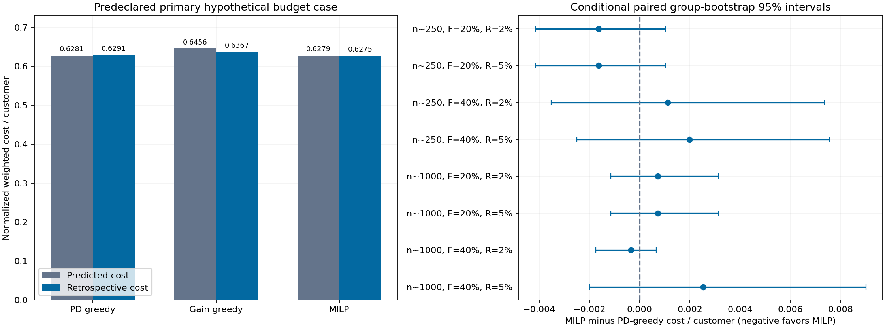

# Shared budgets: sorting suffices in the unit case; packing gain is not proven cost gain

[Protocol](allocation_protocol.md) · [Frozen budget design](../reports/allocation_study/2026-10-27/selection.json) ·
[All paired comparisons](../reports/allocation_study/2026-10-27/paired_effects.csv) ·
[Resource/solver ledgers](../reports/allocation_study/2026-10-27/batch_allocations.csv).

This follow-on was designed after the calibration and hard-capacity study
completed and row verification passed. The budget source/protocol was committed
at `f9ba288` before allocation evaluation. It reuses the same inspected 5,998
historical rows; no new model fitting or untouched holdout is claimed.

## Unit amounts have an exact sorting solution

With unit costs/amounts, common asymmetric error costs and count/funding/predicted
loss upper bounds, a lowest-PD positive-benefit prefix is optimal. Across all
declared unit-weight cells, PD greedy and MILP have identical planning gain and
row memberships. An integer solver adds no decision value in this case.

## Heterogeneous amounts permit packing improvements, usually small here

Seeded clipped-lognormal weights introduce hypothetical unequal resource use.
They are neither actual EAD nor observed lending amounts. Gain per funding unit
equals 1-6*PD in this design, so ratio-greedy is the same ordering as PD-greedy;
it would not constitute an additional distinct baseline.

The primary comparison was fixed in advance: RF sigmoid, target batches 250,
heterogeneous weights, funding .2 of each batch's total weight and predicted
loss budget .02 of total default-loss weight, count capacity .6*N.

| Primary case, across 24 constructed batches | PD greedy | MILP |
|---|---:|---:|
| Approved rows | 1,241 | 1,232 |
| Predicted weighted cost, total | 3,767.315 | 3,766.204 |
| Retrospective weighted cost / row | .629139 | .627498 |
| Total measured decision seconds | .0209 | .8451 |

MILP improves the planning objective by **1.110433** scenario units in total,
about .000185 per row. It changes 73 memberships. The retrospective cost
difference is **-.001640 per row**, conditional paired group-bootstrap 95%
interval **[-.004152, .001030]**. That interval crosses zero: the primary comparison
does not establish a stable retrospective cost improvement over strong PD greedy.

The other seven calibrated heterogeneous-resource cells also have intervals
crossing zero against PD greedy, with both positive and negative cost changes.
The weaker absolute-gain heuristic is retained but is not used to advertise a
large gain while omitting the stronger comparator. All 64 comparisons remain.

In the primary case, funding is nearly exhausted while count and aggregate
predicted-risk budgets have slack. MILP mostly repairs discrete packing; this
does not establish that expanding the predicted-risk budget or changing the
probability model is the binding improvement. Increasing the funding fraction
is a separate scenario, not an identified profitable lending expansion.



## Solver quality and operational interpretation

480 MILPs and two feasible greedy methods produce 1,440 batch-algorithm cells.
All obey count, funding and predicted-loss caps. Every MILP returns a feasible
incumbent and satisfies the configured planning-gain precision; the largest
relative gap is 9.95e-5 (the limit is 1e-4). No returned plan required retaining
the greedy fallback in this run. Exact zero-gap optimality is not claimed.

The implementation always checks both greedy solutions and preserves the best
if the solver lacks a better feasible candidate. Independent enumeration tests
verify a small counterexample and the exact unit-weight case. No algorithm reads
default labels before selecting membership.

104 of the 1,440 reused scenario cells have realized default-loss weight above
their predicted-loss budget, despite zero numerical predicted-resource breaches.
These cells are correlated artificial workloads, not a future breach-frequency
estimate. A calibrated PD plus an expected-loss cap is not a realized-loss or
tail-risk guarantee.

Given this evidence, **use the exact prefix in unit-weight cases; retain feasible
PD greedy as the practical default for this heterogeneous design, with MILP as a
checked planning benchmark**. The experiment establishes neither universal greedy
optimality nor sufficient realized benefit to select MILP on this primary case.
Potential value in other resource structures must be tested with a new declared
design, not selected from these already inspected rows.

## Verification and limits

```bash
python scripts/verify_allocation.py --run-dir reports/allocation_study/2026-10-27
python scripts/verify_allocation.py --run-dir reports/allocation_study/2026-10-27 --baseline reports/generated/decision_baseline
```

The full private replay recomputes all 1,440 resource and cost ledgers and all
64 paired bootstrap effects from saved memberships. The public check verifies
hashes, source/prior provenance, recorded resources, precision and unit-case
agreement, without claiming to reconstruct unpublished rows.

The study has hypothetical costs, resources and assigned amounts, no reviewer
outcomes, no action-dependent default model, no external future cohort and no
retraining uncertainty. It is retrospective classification-cost allocation,
not a causal approval intervention, realized bank profit or production evidence.
